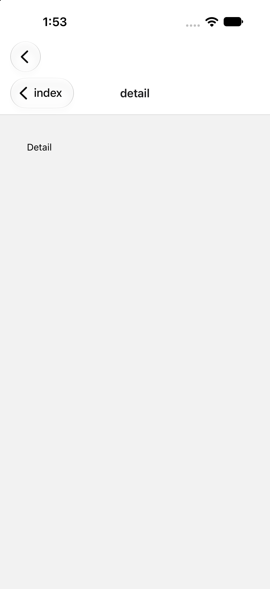

# react-native-screens: collapsed split shows a second navigation bar

Minimal reproduction for an iOS issue in react-native-screens 4.26.2: when a
`SplitView` column (expo-router) contains its own native `Stack`, the collapsed
split shows the column's navigation bar **and** the stack's.

- **Standard iPhone:** two stacked navigation bars. The outer one has only
  "‹ Back", even on the stack's root screen.
- **iPhone Duo (closed):** both back buttons overlap in the vertical bar.

The outer back button pops to the sidebar column. While the split is collapsed,
that column has no visible control to return to the main column in this
reproduction.

| iPhone 18 Pro simulator, iOS 27.0 | iPhone Duo simulator (closed), iOS 27.1 |
| --- | --- |
|  |  |

## Versions (pinned)

Every version in `package.json` is exact, and `package-lock.json` is committed.

| Package | Version |
| --- | --- |
| expo | 57.0.27 |
| expo-router | 57.0.25 |
| react-native-screens | 4.26.2 |
| react-native | 0.86.3 |
| react | 19.2.4 |
| react-dom | 19.2.4 (pinned to match react; expo-router pulls it in for web) |
| react-native-safe-area-context | 5.7.0 |

Tested with:
- Xcode 27.1 (27A9275), iOS 27.1 SDK, on macOS 27.0, Node 22.22.1, npm 10.9.4
- Simulators: iPhone 18 Pro (iOS 27.0) and iPhone Duo (iOS 27.1)
- Not tested on physical hardware

## Setup

```sh
npm ci
npx expo prebuild --platform ios
cd ios && pod install && cd ..
npx expo run:ios --configuration Release
```

`npx expo run:ios` lets you pick a simulator. To build without Metro, use
`xcodebuild`:

```sh
cd ios
xcodebuild -workspace SplitRepro.xcworkspace -scheme SplitRepro \
  -configuration Release -sdk iphonesimulator \
  -destination 'generic/platform=iOS Simulator' -derivedDataPath build \
  CODE_SIGNING_ALLOWED=NO build
xcrun simctl install booted build/Build/Products/Release-iphonesimulator/SplitRepro.app
xcrun simctl launch booted dev.repro.splitview
```

`plugins/with-scene-delegate.js` adopts the UIScene lifecycle. Without it,
iOS 27 traps at launch (`_UIApplicationEvaluateRuntimeIssueForNoSceneLifecycleAdoption`).
That plugin is unrelated to the bug.

## Steps

1. Run on an iPhone simulator in portrait, so the split is collapsed. For the
   iPhone Duo, close the device in DeviceHub.
2. On the first screen, note the bar.
   - Expected: no back button.
   - Actual: an outer bar with "‹ Back".
3. Tap **Open detail**.
   - Expected: one back button ("index").
   - Actual: two, the outer "‹ Back" and the stack's "‹ index".
4. Tap the outer back button.
   - The sidebar column ("Sidebar") is shown, with no bar items and no
     visible control to return to the main column in this reproduction.

## License

MIT (see `LICENSE`). Third-party notices are in `NOTICE`.

## Files

- `app/_layout.tsx`: `SplitView` with one sidebar column and
  `topColumnForCollapsing="secondary"`.
- `app/(main)/_layout.tsx`: a plain `Stack` in the main column.
- `app/(main)/index.tsx`, `app/(main)/detail.tsx`: two screens.
- `plugins/with-scene-delegate.js`: UIScene lifecycle, needed to launch on iOS 27.
- `screenshots/`: the detail screen on both simulators.
